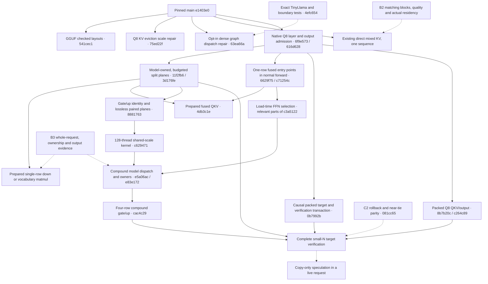

# Rebuilding the primary research track from main

The candidate base is e1403e0. The experimental baseline is 48c6333,
470 commits ahead. The source IDs below expand to immutable objects in the
[commit ledger](commits.tsv). These are dependency and review boundaries.
The final feature selection depends on the serial M40 runs. All existing
defaults, including compressed KV for supported generation, remain the
reference behavior.

GitHub resolved both branch names to the same full commits on November
22. The pinned main worktree was clean when both patch checks ran.
Recheck the remote heads at final handoff.
[Remote main](https://github.com/GuyPaddock/m40-llm/commit/e1403e0dbe2037cd8fc2b0af32addf97a4df3488) ·
[Remote Phase 4](https://github.com/GuyPaddock/m40-llm/commit/48c63332462e009964e891be1cabaf139e3b50f8).

The ledger records each source commit's full Git ID, subject and original
author. For a future port of an intact patch, preserve its Git author and
record the source hash in the port's commit message. For a port assembled
from several patches, identify the contributing commits and the hunks
adapted for main. Preserve applicable author trailers and copyright or
license notices from the source. The November technique references have
their own [upstream revisions](../2026-11-21-protocol/upstream-prs.tsv).
For example, the OpenCL multi-column study motivated C1's weight reuse.
The Maxwell implementation to trace is this project's 0676570.

## Independent fixes

The first review series has two atomic commits. The GGUF change can go
first because it stays within tensor validation and its CPU regression.
The Q8 scale repair can then be reviewed and tested on its own CUDA path.
Each patch independently passed a read-only application check on e1403e0.
Their paths are disjoint. The graph repair follows only if the corrected
boundary and real-model fixtures qualify the main port.

| Order | Proposed commit | Changes and verification |
|---:|---|---|
| 1 | `fix(gguf): check device tensor sizes` | Port 541cec1 with its `gguf_device_views` tests. Run locked CPU checks and validate existing legal layouts and malformed shapes before device allocation. |
| 2 | `fix(cuda): synchronize Q8 history scales` | Use the two barriers from 75ed22f and include the guarded incremental test from a898ac2 in the same commit. Repeat it and `attention_parity_cuda_grid` with cuBLAS on and off. Record the successful unfixed main control and the Phase 4 failure witness. |

Run these checks from a clean e1403e0 checkout in the same repository.

```bash
git diff 541cec1^ 541cec1 | git apply --check
git diff e1403e0 75ed22f -- cuda/kernels.cu tests/q8_kv_scale_reuse.rs \
    tests/common/guarded_bytes.rs | git apply --check
```

1. **GGUF shape validation.** Main-based 541cec1 checks products and row
   strides in `src/infer/tensor_views.rs` and reuses the checked result in
   `src/infer/load.rs`. Include `tests/gguf_device_views.rs`. No CUDA
   dependency or flag. Debug/release checks and existing host regressions
   are recorded at 1989d82.
2. **Two barriers in Q8 KV history conversion.** Both kernels already exist
   on main. The first converts old dense K/V vectors. The second quantizes
   single evictions. Each must finish reading the K maximum before reusing
   shared memory for V. The source patch from e930d21 applies directly to
   `cuda/kernels.cu`. Main-based 75ed22f contains precisely those barriers.
   a898ac2 brings the unchanged eviction regression and its small guard
   helper. These use the main cache API without a prepared-Q8 projection
   backend. Keep this correction independent of weights, graph execution
   and block selection. Bulk conversion's public API requires both dense
   storage and a Q8 sidecar. Main only allocates this sidecar in the
   compressed constructor. Report the bulk path as compiled; exercise
   incremental eviction and existing attention parity on hardware.
   At a383c40, both repaired main builds passed the incremental fixture
   and ten attention tests on the M40. The unrepaired main control also
   passed. Use the Phase 4 failure witness alongside these port checks.
3. **Opt-in dense graph state correctness.** Main already has graph
   capture, replay and device-resident sequence lengths in
   `src/decode_session.rs`. Its ordinary last-token GQA uses 128 threads
   for head64 and head128 through length 8192, with a separate head64
   `ldg_kv` path. Its device-length launcher uses a one-thread scalar
   kernel. This is the same dispatch discrepancy as the repaired study.
   The full e2b4739 patch fails a read-only application check in all three
   runtime files. Port the common launcher and predicates to the three
   existing specialized kernels and the scalar fallback in
   `cuda/kernels.cu`. Keep both C entry points. Reserve capture-time
   dynamic shared memory for the maximum specialized length and activate
   exactly one writer at 8192/8193. Main has no Phase 4 parallel-head128
   backend, layer-mask subsystem or Q8 timing events to import for this.
   Keep `M40LLM_DECODE_GRAPH` opt-in. Port the dispatch and session
   fixtures to main's test structure, check ordinary/replay logits and KV
   bits, cache guards, cancellation, multiple launches and teardown with
   cuBLAS on/off. bfae111 establishes Phase 4 correctness. Speed has
   separate capture, replay, and full-request gates.

   The repaired attention launcher is independent of the F16 projection
   backend. On e1403e0, the graph forward path joins the prefill stream
   before QKV. `src/infer/gemm.rs::matmul_f32xf16_gguf_f32_async` uses the
   async FP32 materialized path only when cuBLAS and that layout are
   available. Its native F16 fallback calls
   `cuda/kernels.cu::m40llm_gemm_f32xf16_gguf_f32`, which synchronizes
   the prefill stream joined by capture. The main retry therefore
   distinguishes actual replay from ordinary fallback in both build modes.
   Phase 4's async native F16 controls use a separate implementation at
   adbccd6. Include it in a port only if an observed unsupported graph
   combination justifies that additional dependency.

## Qwen Q8 admission precedes all prepared-weight proposals

A real main loader rejects both layer-0 Q8 wq and the tied Q8 output head.
Main already reads Q8 token embeddings. Checking embeddings alone misses
both failures. The immutable model bytes and the real main errors are
recorded on research/1121-main-baseline at dd81f05. TinyLlama F16 maps all
22 layers, shares all 46 input IDs and the stop IDs, and has the same 2048
capacity on both builds. In the explicit dense cross-branch comparison at
ce1cc26, main delivered 25.993 HTTP tokens/s and Phase 4 delivered
20.944 with the same 128 greedy IDs. Each proposed mapping or execution
port can be checked against main on this unchanged F16 path. Repeat the
paired comparison on the same host and request. Record output equality,
client wall time and peak sampled process memory. The default-cache
comparison at d336635 also matched all IDs. Phase 4 gained 4.028%
buffered throughput on the separate default-cache control, and fell
below the 5% threshold. Retain both baselines when qualifying a
combined port. Their differences span whole revisions.
[Explicit dense baseline](../2026-11-21-serving-baseline/tiny-dense/README.md) ·
[Default-cache baseline](../2026-11-21-serving-baseline/tiny-default/README.md).
Use Phase 4 for Qwen Q8 performance until a main port runs the real model.
The same preformatted Qwen text also gains an extra BOS on main.

4. **Native Q8 layer projection.** Use the shape and block-stride checks,
   `m40llm_*` CUDA entry points, non-CUDA stubs, Rust wrappers and native
   FP32 accumulation in 6f9e573. Port `src/infer/mapping.rs` and both
   synchronous and asynchronous `src/infer/gemm.rs` branches. The
   original diff follows the memory-budget/materialization refactor
   b0fb851. Dispatch by the existing GGUF tensor dtype before any
   materialization fallback. No reason to import a new global backend
   policy just to admit Q8. Run gemm_mixed and map_standard_layer, include
   wrong shapes, tails and unsupported formats, and compare the other
   supported paths with their unmodified controls.
5. **Q8 tied and explicit output heads.** Carry the mapping and vocabulary
   projection rules at 616d628 in `src/infer/mapping.rs` and
   `src/infer/logits.rs`. Include q8_generation_canary from 2f7b89a and
   the tied-head cases. Require actual full-layer CUDA forward, output
   logits, sampled IDs and model memory for the exact Qwen fixture.
   Record prompt framing explicitly. Do not port the experimental
   branch's generation template merely to match its benchmark.
6. **Model-owned prepared buffers, only for qualifying families.** The
   lossless split-plane packing and CUDA consumer (a48d87b) require checked
   layout sizes, allocation ownership and a lifetime tied to the model
   (33891e8, 11f2fb6). Review final-owner deallocation accounting at
   81948df where relevant. Add the admission budget and family selection
   from 3d176fe to `src/infer/execution_weights/{device,cache,runtime}.rs`
   with an off fallback. Exercise clones, pointer separation, partial
   allocation failure, teardown, budget rejection and native fallback.
   `M40LLM_Q8_EXECUTION_WEIGHTS`, `M40LLM_Q8_EXECUTION_BUDGET_MB` and
   `M40LLM_Q8_EXECUTION_FAMILIES` are the opt-in controls. Measure peak
   total VRAM, including native weights still used by prefill.
7. **Choose individual Q8 consumers after B3.** Compare the prepared QKV
   candidate at 4db3c1e and greedy vocabulary at b76177d against their
   native controls. Keep e2dbc61 only as the rejected prepared MLP control.
   Later changes include dd8c5f6 for down-reduction order, 05607ab for
   split FFN, e5a06ac and e83e172 for compound FFN and joint-only
   ownership. Commit only each admitted consumer and its tests. Include
   q8_prepared_qkv, q8_prepared_mlp, q8_prepared_greedy, q8_runtime_weights
   and q8_family_selection where applicable. Verify native multirow,
   nongreedy and unsupported fallbacks. Compare complete FFN, prefill and
   HTTP; the observed short down/vocabulary result carries an extra
   1,192,935,424 bytes. The post-pause repeat at e25b2ed reproduced an
   11.776% gain. The isolated peak-residency comparison remains open.
   Once compound qualifies, keep the joint-only owner from e83e172 and
   retain the explicit `M40LLM_Q8_FFN_OWNERSHIP=retain-split` diagnostic.
   Its [matched ownership comparison](../2026-11-22-q8-ownership/README.md)
   measured 1,647 MiB less loader peak with exact logits and HTTP
   non-regression. The combined packet and argmax portfolio at 7ff9d33
   reproduces a 3.842% gain against the already prepared joint-FFN
   control. That falls below the November 5% gate and the 56.153149
   historical target. All arms owned 1,192,935,424 packet bytes.
   Keep the narrower selective-preparation comparison separate from
   the portfolio and position the latter after its full owners and
   compound dependencies.

## Conditional paths and explicit exclusions

- **Direct mixed KV on a single sequence** is already on main.
  `src/kv_compression.rs` validates the compatible backing/consumer, and
  `cuda/kernels.cu` already implements the staged and direct old-value
  consumers. No import is needed. Extend regression/quality and live
  allocation coverage independently. Keep November's 97102a1 staged
  comparison, 9489bb6 residency probes and f1bb7a4 beyond-top64
  equivalence checks as research evidence. Report dense-failing tasks
  separately. In the Phase 4 TinyLlama head64 run at c8ddabe, the direct
  consumer gained 8.775% complete HTTP throughput with identical IDs
  and 16 MiB lower sampled process peak. It supports retaining the
  direct path. Qwen head128 has no staged serving control.
  An actual new batched feature would require the slot index,
  variable-length dispatch, ownership, `src/decode_batch.rs`, server and
  forward changes from 7f3bcfd, plus attention_batched_varlen and
  server_smoke. Only consider that port after a serving result.
- **Small-N target verification** builds on native Q8, owned weights,
  causal packed forward, workspace and transactional metadata at 0b7992b.
  Research-only 9aff60a binds the four-row backend to
  `src/infer/direct_verification.rs` and `src/verification.rs`. 0676570
  adds the four-column FP32 CUDA kernel, `build.rs` input tracking, stub,
  device owner wrapper and guard test. a438032 gates the six-row-count
  benchmark. Exact-verification rollback and near-tie cases (9d55c9a,
  fc487e8, 081cc65) precede live dispatch. Phase 4 evidence at 837e070
  clears the complete target gate against the fastest exact control.
  The opt-in verifier still needs the ordered foundation and guard
  tests on a clean main-based port. Keep the stable Q8 model-support
  changes independent of drafting and multi-request scheduling.
- **Sparse Q4** host packing 3df1dd2 precedes selected-device owner
  9a68003. They exist on Phase 4 as explicit calls and controls for
  SpQt; no live causal selector qualified. A stable port would require
  Q4 GGUF admission and a measured benefit after indexing, compaction
  and resident layout costs. The charged SwiGLU operator screen at
  be7bf4b admits the three-layer real-model quality check at 5324ba5.
  The driver at 0736f06 reuses the measured arithmetic and existing
  research exclusions. Keep it outside the stable sequence until
  the quality and complete-request gates qualify.
- A5 benchmark clients, optional timing clocks, D3 fairness diagnostics
  and oracle adapters are evidence tools. Main-serving changes require
  their own review and measured scheduling case. Preserve main's existing
  simple HTTP response contract.

### Where a mixed prefill/decode tick spends its time

Main already has a dense buffered scheduler. Its packed prefill requires
head dimension 64. Phase 4 also admits dimension 128, used by D3's Qwen.
At e1403e0, `src/server.rs::process_scheduler_batch_tick` separates pending
prefills from active decodes. A single arriving prompt is ineligible for
batched prefill even when another request is decoding. The scheduler calls
`DecodeSchedulerRequest::step` on that prompt before servicing the decode.
`DecodeSession::logits_for_ids` in `src/decode_session.rs` processes every
remaining prompt token in the call. The scheduler holds the generation lock
until the tick returns. The measured Phase 4 source at cfb9df0 uses the same
order for dense KV. This explains how a stall can occur. Its frequency and
size require the D3 two-client traces.

If D3 admits a chunking experiment, reuse the session's existing
`processed_len()` cursor. On both revisions, passing `&ids[..end]` to
`logits_for_ids` starts at that cursor, preserves absolute positions and
sets the cursor to `end` after a successful return. The existing sequential
path already computes logits at every position. An initial chunking
experiment can retain that arithmetic and discard intermediate results.
Sample only after the full prompt completes.

Both revisions classify a request as pending prefill only while
`processed_len() == 0`. A partial prompt must remain eligible for its
next sequential chunk. Keep it out of packed prefill: `prefill_sequence`
passes the entire prefix from position zero. Sending a partially processed
request there would replay its history. Test a second pending prefill
arriving after the first chunk as well as arrivals during decode,
one-token and uneven final chunks, exact generated IDs and valid KV,
cancellation between chunks, and sequence-slot reuse. The experiment can
use main's existing scheduler and dense sequence leases independently of
the Phase 4 compressed batched-prefill backend.

For a final port, execute the affected tests first, then formatting, locked
non-CUDA tests with warnings denied, CUDA/server Clippy, CUDA cuBLAS both
ways and the matched real CLI/HTTP cases. Each correctness or performance
commit needs a trace to the source revision plus its own reproduction on
the chosen integration base. Current research branches are independent
and no integration branch has been created.

## Minimum runtime dependencies and qualification order

Solid arrows show capabilities required by a consumer. Dotted arrows show
measurements required before proposing a port. Each optional family can be
reviewed and rejected independently.



**Port boundaries that change the estimate.** Main's single-token forward
calls `qkv_project_f32xf16_gguf_f32_async`, `mlp_gates_f32xf16_gguf_f32_async`
and the separate down projection. Multirow prefill also uses these APIs.
The Q8 dtype dispatch in both ordinary GGUF matmul methods (6f9e573) and
the mapped output head (616d628) are sufficient starting points for
native Q8 admission. Reuse main's checked shapes and view metadata.
Test a real full forward before crediting any family hit.

For down and vocabulary, 11f2fb6 already attempts the model-owned
`try_project` in the synchronous and asynchronous GGUF matmul paths.
b76177d changes greedy dispatch when prepared vocabulary is present.
Its fast token path presupposes a device logits buffer, argmax and one
token readback (introduced at 6629f75). A minimal main port can use the
prepared matmul with its existing full-logit/host sampler. It must
measure its own latency. Matching the historical greedy HTTP workload
requires the greedy device path and stable ties, stop handling, buffer
lifetime and nongreedy fallback. Keep that as a separate optional commit.

Prepared fused QKV and gate/up do not attach to main's ordinary three-
and two-matmul methods by applying 4db3c1e or e2dbc61. Both insert calls
*inside existing one-row fused dispatch* introduced at 6629f75 and extended
for Q8 at c71254c. Port only the selected forward call site, dtype/shape
guard, required stream dependency and prepared wrapper. Preserve main's
ordinary path when the prepared owner is absent or the row shape differs.
The historical native-fused control is necessary to attribute a claimed
prepared-versus-native-fused improvement. Admitting native Q8 does not
require every fused kernel. Likewise, do not import the entire F16
optimization, sampling, or server diff from 6629f75 as a prerequisite.

**Output-head selection is part of correctness.** On e1403e0,
`map_lm_head` rejects an unsupported dedicated output type before looking
for tied embeddings. Later 54226d7 allows another fall-through from an
unsupported dedicated type to a compatible embedding. Preserve the
narrow 616d628 Q8 mapping when porting Q8. Test supported dedicated Q8,
absent-head tied Q8, wrong tied shape, and an unsupported dedicated head
with otherwise usable embeddings. Record the exact selected tensor name,
type and tied flag. The Q4 secondary admission (4d0a79f) selected a real,
dedicated Q6_K head; it did not rely on tied substitution. Q4 support
and its slower historical 32-token probe require separate review.

**Quantized KV has two separate decisions.** The early snapshot 44f15e9
retained two top-8 counterexamples. The completed 48-case grid at b072baf
found three losses among ten dense-passing long tasks. The aligned logits
at 9d4b78c also show the greater drift under top-8. Its
existing use in supported generation on both bases makes this a recorded
default-behavior risk. Changing its default needs separate authorization
and quality/serving evidence. A sidecar-stride redesign is also unnecessary
for this single-request promotion gate. The byte reconciliation at 46b4a46
bounds its potential savings at 23,887,872 bytes. B2's ownership and
peak measurements still govern any memory claim.

## Conditional compound FFN port

The runtime branch for `JointSharedScales` in
`src/infer/gemm.rs::try_mlp_gate_up_swiglu_f32xf16_gguf_decode_async`
gets the model-owned pair and enqueues its shared-scale kernel directly.
The generic prepared fused MLP at e2dbc61 lost to native fused execution
in the 2e2bb5c HTTP study. It is a historical control. The compound
consumer has its own kernel, arithmetic and ownership prerequisites.
The rebuild diagram above follows that direct call.

If the full compound family qualifies against the best native main path,
split the optional port into the following reviewable changes.

1. **Pack one pair losslessly.** Port the host `Q8FfnPairKey` and
   `HostQ8FfnPair::pack` from 8881763 after Q8 source identities and
   checked matrix shapes exist. Each record retains both original
   FP16 scale bit patterns and four signed payload bytes per source.
   Reject cross-model pairs, repeated sources, incompatible shapes,
   incomplete blocks and size overflows. Include the host packing and
   invalid-pair cases in `src/infer/execution_weights/ffn_pair.rs`.
2. **Execute one explicit pair on Maxwell.** Port `DeviceQ8FfnPair`
   with two decode-accessible device planes, its Rust call in
   `src/cuda/q8_ffn.rs`, the C ABI
   `m40llm_ffn_q8_joint_shared_scales_f32_async`, and
   `gate_up_joint_f32x4_shared_scales` from c629471. Preserve the
   `reduce_published<128>` summation order from 38e14a0, the input
   alignment checks, K divisible by 32 and K ≤ 4096. The kernel uses
   128 threads and 1,024 + 8 × (K / 32) bytes of dynamic shared memory
   per block. Track the included CUDA header in `build.rs`. Port the
   relevant cases from `tests/q8_ffn_joint.rs`. The one-row consumer
   has no need for the four-row verification session or the ablation
   variant selector.
3. **Admit compound at model load.** Port the pair planner and budget
   checks in e5a06ac, the model-local configuration boundary from
   c3a5122, and the one-row forward call. Build all pair plans before
   upload; ensure a failed later pair releases earlier device owners.
   Exercise budget rejection, duplicate sources, 36 real pairs, source
   pointer mapping and original GGUF-backed prefill. Keep the native
   selection as the ordinary default.
4. **Select the physical owners.** From e83e172 and a37cedc carry the
   explicit `retain-split` and `joint-only` options and the latter's
   selection only inside the opt-in compound configuration.
   `M40LLM_Q8_EXECUTION_WEIGHTS=split`,
   `M40LLM_Q8_EXECUTION_FAMILIES=gate-up,down,vocabulary` and
   `M40LLM_Q8_FFN_KERNEL=joint-shared-scales-128` select the measured
   family. The control sets `M40LLM_Q8_FFN_OWNERSHIP=retain-split`.
   Keep down and vocabulary owners and original GGUF data; remove just
   the redundant gate/up split planes. Include
   `test_joint_only_ownership_matches_retained_compound` and
   `test_compound_combined_budget_failure_releases_model`. Repeat
   the fixed full-logit, token, HTTP and single-process memory checks
   on the actual integration revision before claiming its resource gain.

The November ownership comparison prices step 4 inside an existing
compound engine. It supplies no speed estimate for steps 1–3 on main.

## What a four-row verifier actually requires

C1 tests the down projection inside an existing direct verifier. A
standalone split-plane GEMV can be ported independently; the observed
operator result does not qualify the full verifier as an independent
addition to main. The following dependencies are checked by
`DirectVerificationWorkspace::new` in
`src/infer/direct_verification.rs` at 5a2966b.

- **Exact model and cache.** The direct path requires 36 layers, D=2048,
  FFN width 11008, 16 query heads and two head128 KV heads. The dense
  cache must own exclusive storage for the 36 layer slots. All required
  Q8 projections, prepared vocabulary and a 4-column/256-thread split
  down owner must be present. The path uses a private session workspace
  and the decode stream. Ordinary compressed serving cannot be routed
  through this verifier with unchanged cache semantics.
- **Attention and gate/up dependencies.** Porting the measured verifier
  would require the packed GGUF QKV/output operators from 8b7b20c with
  the guarded `PackedWarp256` model dispatch from c264c89. The target
  uses the four-row compound gate/up entry point from cac4c29. Its three
  single-token tails use the ordinary joint-only path. The measured
  configuration also uses the packed prefix and greedy head. Minimum
  tests include `q8_attention_projection_runtime`, `q8_four_row` and the
  ordinary versus direct full-model fixture. The C1 experiment changes
  none of these stages.
- **New kernel and dispatch.** The down specialization at 0676570
  changes `cuda/q8_small_rows.cuh`, its build/FFI wiring, and the
  prepared device owner. It shares dequantized weights within a block
  across at most four input rows and preserves FP32 accumulation. The
  M40 four-row specialization uses 93 registers per thread, 256 threads,
  4,096 dynamic shared bytes per block and zero reported stack or local
  bytes. Physical DRAM transactions were unmeasured. The session change
  at 5a2966b selects the candidate separately from both the serial and
  existing multi-row controls. Retain ordinary serial down projection
  in the existing constructor.
- **Promotion boundary.** Include `tests/q8_separate_projection.rs`
  and C2's `tests/exact_verification.rs`. Require agreement on all 511
  full logit-row digests, the final valid dense KV, each accepted prefix,
  rollback and the correction before ranking total target latency. The
  three-arm qualification runner at b0afd1b measures 127 actual four-row
  transactions per request plus three tails; 2dff3f8 binds the binary,
  input and preflight. The result at 837e070 measured 58.316 ms serial,
  56.417 ms multi-row split and 53.102 ms shared weights for complete
  begin-through-commit latency. Against the faster control the
  reduction was 5.876%, paired 95% interval 5.803–5.979%, across 20
  confirmation rounds. Confirm all three guards and the 60 raw
  rejection/correction transactions when porting. The separate live
  copy comparison is frozen at 0890799 and uses the three-arm CLI
  harness at 16b29d0. It measures the same causal drafter on both
  schedules against ordinary decode, with actual copy acceptance and
  complete resident request timing.

The [target cost replay](../2026-11-22-verifier-rejections/README.md)
counts 18,396 down launches in the serial-down verifier per 512-token
request. Both multi-row alternatives use 4,680. A saving against the
serial schedule can include 13,716 fewer launches. The comparison with
the existing multi-row schedule controls for that difference.

**Why the target uses the split multi-row control.** At four input rows,
the existing split kernel and the candidate both matched the serial
control on all 24,576 FP32 outputs across layers 0, 17 and 35. Cached
cuBLAS SGEMM was the fastest alternative control at this width in the
operator study. It differed in 21,113 output bit patterns across those
layers, with maximum absolute difference 0.00000191. Those differences
are small, but a verifier that requires identical logits and valid KV
cannot assume that changing the accumulation order is harmless.

SGEMM also used a 90,177,536-byte FP32 expansion for one down matrix.
Keeping one such expansion for each of the 36 layers would require
3,096 MiB for their payloads. This is a storage calculation; the study
measured one expanded matrix at a time. Charging the dequantization on
every call cost 1.152 ms on layer 0, versus 0.425 ms for already expanded
SGEMM and 0.370 ms for the candidate. Preserve both SGEMM timings as
operator controls. The complete-verifier gate compares schedules that
reuse the same device weights and reproduce the same arithmetic.
[Three-layer timings and numerical controls](https://github.com/GuyPaddock/m40-llm/blob/16fbcc48878d0bb272f7ca17249954b548ba8013/docs/experiments/2026-11-21-small-n/result/operator-audit.json).
