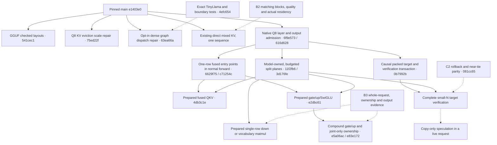

# Rebuilding the primary research track from main

The candidate base is e1403e0. The experimental baseline is 48c6333,
470 commits ahead. The source IDs below expand to immutable objects in the
[commit ledger](commits.tsv). These are dependency and review boundaries.
The final feature selection depends on the serial M40 runs. All existing
defaults, including compressed KV for supported generation, remain the
reference behavior.

## Independent fixes

1. **GGUF shape validation.** Main-based 541cec1 checks products and row
   strides in `src/infer/tensor_views.rs` and reuses the checked result in
   `src/infer/load.rs`. Include `tests/gguf_device_views.rs`. No CUDA
   dependency or flag. Debug/release checks and existing host regressions
   are recorded at 1989d82.
2. **Two barriers in Q8 KV history conversion.** Both kernels already exist
   on main. The first converts old dense K/V vectors. The second quantizes
   single evictions. Each must finish reading the K maximum before reusing
   shared memory for V. The source patch from e930d21 applies directly to
   `cuda/kernels.cu`. Main-based 75ed22f contains precisely those barriers.
   a898ac2 brings the unchanged eviction regression and its small guard
   helper. These use the main cache API without a prepared-Q8 projection
   backend. Keep this correction independent of weights, graph execution
   and block selection. Bulk conversion's public API requires both dense
   storage and a Q8 sidecar. Main only allocates this sidecar in the
   compressed constructor. Report the bulk path as compiled; exercise
   incremental eviction and existing attention parity on hardware.
3. **Opt-in dense graph state correctness.** Main already has graph
   capture, replay and device-resident sequence lengths in
   `src/decode_session.rs`. Its ordinary last-token GQA uses 128 threads
   for head64 and head128 through length 8192, with a separate head64
   `ldg_kv` path. Its device-length launcher uses a one-thread scalar
   kernel. This is the same dispatch discrepancy as the repaired study.
   The full e2b4739 patch fails a read-only application check in all three
   runtime files. Port the common launcher and predicates to the three
   existing specialized kernels and the scalar fallback in
   `cuda/kernels.cu`. Keep both C entry points. Reserve capture-time
   dynamic shared memory for the maximum specialized length and activate
   exactly one writer at 8192/8193. Main has no Phase 4 parallel-head128
   backend, layer-mask subsystem or Q8 timing events to import for this.
   Keep `M40LLM_DECODE_GRAPH` opt-in. Port the dispatch and session
   fixtures to main's test structure, check ordinary/replay logits and KV
   bits, cache guards, cancellation, multiple launches and teardown with
   cuBLAS on/off. bfae111 establishes Phase 4 correctness. Speed has
   separate capture, replay, and full-request gates.

## Qwen Q8 admission precedes all prepared-weight proposals

A real main loader rejects both layer-0 Q8 wq and the tied Q8 output head.
Main already reads Q8 token embeddings. Checking embeddings alone misses
both failures. The immutable model bytes and the real main errors are
recorded on research/1121-main-baseline at dd81f05. TinyLlama F16 maps all
22 layers, shares all 46 input IDs and the stop IDs, and has the same 2048
capacity on both builds. Use this for the cross-branch A2 comparison.
Use Phase 4 for Qwen Q8 performance until a main port runs the real model.
The same preformatted Qwen text also gains an extra BOS on main.

4. **Native Q8 layer projection.** Use the shape and block-stride checks,
   `m40llm_*` CUDA entry points, non-CUDA stubs, Rust wrappers and native
   FP32 accumulation in 6f9e573. Port `src/infer/mapping.rs` and both
   synchronous and asynchronous `src/infer/gemm.rs` branches. The
   original diff follows the memory-budget/materialization refactor
   b0fb851. Dispatch by the existing GGUF tensor dtype before any
   materialization fallback. No reason to import a new global backend
   policy just to admit Q8. Run gemm_mixed and map_standard_layer, include
   wrong shapes, tails and unsupported formats, and compare the other
   supported paths with their unmodified controls.
5. **Q8 tied and explicit output heads.** Carry the mapping and vocabulary
   projection rules at 616d628 in `src/infer/mapping.rs` and
   `src/infer/logits.rs`. Include q8_generation_canary from 2f7b89a and
   the tied-head cases. Require actual full-layer CUDA forward, output
   logits, sampled IDs and model memory for the exact Qwen fixture.
   Record prompt framing explicitly. Do not port the experimental
   branch's generation template merely to match its benchmark.
6. **Model-owned prepared buffers, only for qualifying families.** The
   lossless split-plane packing and CUDA consumer (a48d87b) require checked
   layout sizes, allocation ownership and a lifetime tied to the model
   (33891e8, 11f2fb6). Review final-owner deallocation accounting at
   81948df where relevant. Add the admission budget and family selection
   from 3d176fe to `src/infer/execution_weights/{device,cache,runtime}.rs`
   with an off fallback. Exercise clones, pointer separation, partial
   allocation failure, teardown, budget rejection and native fallback.
   `M40LLM_Q8_EXECUTION_WEIGHTS`, `M40LLM_Q8_EXECUTION_BUDGET_MB` and
   `M40LLM_Q8_EXECUTION_FAMILIES` are the opt-in controls. Measure peak
   total VRAM, including native weights still used by prefill.
7. **Choose individual Q8 consumers after B3.** Sources are 4db3c1e for
   fused QKV, e2dbc61 for fused MLP and b76177d for greedy vocabulary.
   Later changes include dd8c5f6 for down-reduction order, 05607ab for
   split FFN, e5a06ac and e83e172 for compound FFN and joint-only
   ownership. Commit only each admitted consumer and its tests. Include
   q8_prepared_qkv, q8_prepared_mlp, q8_prepared_greedy, q8_runtime_weights
   and q8_family_selection where applicable. Verify native multirow,
   nongreedy and unsupported fallbacks. Compare complete FFN, prefill and
   HTTP; the observed short down/vocabulary result carries an extra
   1,192,935,424 bytes and still has a quiet-host repeat outstanding.
   Once compound qualifies, keep the joint-only owner from e83e172 and
   retain the explicit `M40LLM_Q8_FFN_OWNERSHIP=retain-split` diagnostic.
   Its [matched ownership comparison](../2026-11-22-q8-ownership/README.md)
   measured 1,647 MiB less loader peak with exact logits and HTTP
   non-regression. A portfolio comparison with compound has a different baseline.

## Conditional paths and explicit exclusions

- **Direct mixed KV on a single sequence** is already on main.
  `src/kv_compression.rs` validates the compatible backing/consumer, and
  `cuda/kernels.cu` already implements the staged and direct old-value
  consumers. No import is needed. Extend regression/quality and live
  allocation coverage independently. Keep November's 97102a1 staged
  comparison, 9489bb6 residency probes and f1bb7a4 beyond-top64
  equivalence checks as research evidence. Report dense-failing tasks
  separately. An actual new batched feature would require the slot index,
  variable-length dispatch, ownership, `src/decode_batch.rs`, server and
  forward changes from 7f3bcfd, plus attention_batched_varlen and
  server_smoke. Only consider that port after a serving result.
- **Small-N target verification** builds on native Q8, owned weights,
  causal packed forward, workspace and transactional metadata at 0b7992b.
  Research-only 9aff60a binds the four-row backend to
  `src/infer/direct_verification.rs` and `src/verification.rs`. 0676570
  adds the four-column FP32 CUDA kernel, `build.rs` input tracking, stub,
  device owner wrapper and guard test. a438032 gates the six-row-count
  benchmark. Exact-verification rollback and near-tie cases (9d55c9a,
  fc487e8, 081cc65) precede live dispatch. Require measured complete
  target cost against the fastest correct control, including rejected
  tokens, before an opt-in verifier or a copy-draft study. No requirement
  to bring a draft generator, controller or multi-request scheduler into
  the stable Q8 model-support changes.
- **Sparse Q4** host packing 3df1dd2 precedes selected-device owner
  9a68003. They exist on Phase 4 as explicit calls and controls for
  SpQt; no live causal selector qualified. A stable port would require
  Q4 GGUF admission and a measured benefit after indexing, compaction
  and resident layout costs. Preserve the research implementations.
- A5 benchmark clients, optional timing clocks, D3 fairness diagnostics
  and oracle adapters are evidence tools. Main-serving changes require
  their own review and measured scheduling case. Preserve main's existing
  simple HTTP response contract.

For a final port, execute the affected tests first, then formatting, locked
non-CUDA tests with warnings denied, CUDA/server Clippy, CUDA cuBLAS both
ways and the matched real CLI/HTTP cases. Each correctness or performance
commit needs a trace to the source revision plus its own reproduction on
the chosen integration base. Current research branches are independent
and no integration branch has been created.

## Minimum runtime dependencies and qualification order

Solid arrows show capabilities required by a consumer. Dotted arrows show
measurements required before proposing a port. Each optional family can be
reviewed and rejected independently.

**Port boundaries that change the estimate.** Main's single-token forward
calls `qkv_project_f32xf16_gguf_f32_async`, `mlp_gates_f32xf16_gguf_f32_async`
and the separate down projection. Multirow prefill also uses these APIs.
The Q8 dtype dispatch in both ordinary GGUF matmul methods (6f9e573) and
the mapped output head (616d628) are sufficient starting points for
native Q8 admission. Reuse main's checked shapes and view metadata.
Test a real full forward before crediting any family hit.

For down and vocabulary, 11f2fb6 already attempts the model-owned
`try_project` in the synchronous and asynchronous GGUF matmul paths.
b76177d changes greedy dispatch when prepared vocabulary is present.
Its fast token path presupposes a device logits buffer, argmax and one
token readback (introduced at 6629f75). A minimal main port can use the
prepared matmul with its existing full-logit/host sampler. It must
measure its own latency. Matching the historical greedy HTTP workload
requires the greedy device path and stable ties, stop handling, buffer
lifetime and nongreedy fallback. Keep that as a separate optional commit.

Prepared fused QKV and gate/up do not attach to main's ordinary three-
and two-matmul methods by applying 4db3c1e or e2dbc61. Both insert calls
*inside existing one-row fused dispatch* introduced at 6629f75 and extended
for Q8 at c71254c. Port only the selected forward call site, dtype/shape
guard, required stream dependency and prepared wrapper. Preserve main's
ordinary path when the prepared owner is absent or the row shape differs.
The historical native-fused control is necessary to attribute a claimed
prepared-versus-native-fused improvement. Admitting native Q8 does not
require every fused kernel. Likewise, do not import the entire F16
optimization, sampling, or server diff from 6629f75 as a prerequisite.

**Output-head selection is part of correctness.** On e1403e0,
`map_lm_head` rejects an unsupported dedicated output type before looking
for tied embeddings. Later 54226d7 allows another fall-through from an
unsupported dedicated type to a compatible embedding. Preserve the
narrow 616d628 Q8 mapping when porting Q8. Test supported dedicated Q8,
absent-head tied Q8, wrong tied shape, and an unsupported dedicated head
with otherwise usable embeddings. Record the exact selected tensor name,
type and tied flag. The Q4 secondary admission (4d0a79f) selected a real,
dedicated Q6_K head; it did not rely on tied substitution. Q4 support
and its slower historical 32-token probe require separate review.

**Quantized KV has two separate decisions.** Mixed top-8 failed two
dense-passing long tasks on research/1121-quantized-kv 44f15e9. Its
existing use in supported generation on both bases makes this a recorded
default-behavior risk. Changing its default needs separate authorization
and quality/serving evidence. A sidecar-stride redesign is also unnecessary
for this single-request promotion gate. The byte reconciliation at 46b4a46
bounds its potential savings at 23,887,872 bytes. B2's ownership and
peak measurements still govern any memory claim.
